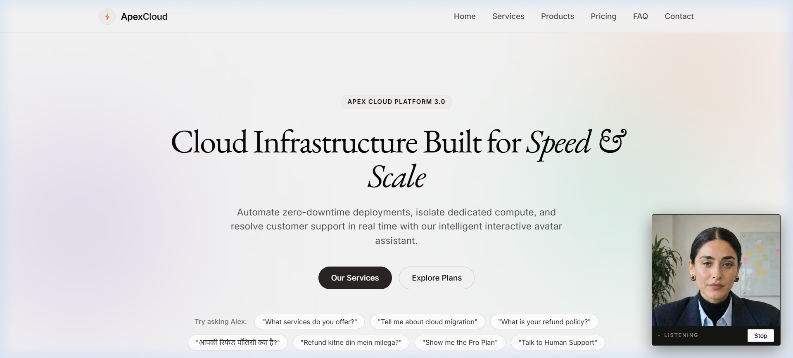

# AI Customer Support Avatar (Interactive WebRTC Agent)

A production-grade, interview-ready AI Customer Support Avatar application. The interactive avatar communicates in **English, Hindi, and Hinglish** with sub-second latency, responds using a verified and transparent domain knowledge base (`knowledge.json`), and actively navigates and highlights elements on a live SaaS web interface.

Built using **LiveKit Cloud WebRTC**, **Synthesia Interactive Avatar**, **OpenAI GPT-4o-mini**, **Silero VAD**, and **OpenAI Whisper STT / TTS**.

---

## 📸 Overview & Visual Interface



- **Zero-Padding Edge-to-Edge Avatar Frame**: Minimalist, industrial-style container docked at the bottom-right corner of the website.
- **Real-Time Dynamic State Markers**: Visual feedback for `SPEAKING`, `LISTENING`, and `READY` states with ambient pulsation.
- **Bi-Directional Browser Control**: The avatar programmatically scrolls the webpage and highlights relevant service cards and pricing tiers as it explains them.
- **Strict Security Boundaries**: All sensitive credentials remain purely on the backend. The frontend operates via cryptographically signed, short-lived room tokens and allowlisted DOM actions.

---

## 🏛️ System Architecture

```
                       +---------------------------------------+
                       |             User Browser              |
                       |  • Microphone audio capture           |
                       |  • Synthesia Avatar video playback    |
                       |  • Real-time DOM actions (Highlight)  |
                       +-------------------+-------------------+
                                           ^
                      WebRTC Audio/Video   | LiveKit Data Channel (topic="ui")
                                           v
                       +---------------------------------------+
                       |          LiveKit Cloud Room           |
                       +-------------------+-------------------+
                                           |
                       +-------------------+-------------------+
                       |      Python Agent (agent.py)          |
                       |                                       |
                       |  1. Silero VAD (Speech detection)     |
                       |  2. OpenAI Whisper (STT)              |
                       |  3. OpenAI gpt-4o-mini (LLM)          |
                       |     ├── Language Detection            |
                       |     ├── Keyword Scoring Search        |
                       |     └── Allowlisted Function Tools:   |
                       |         • navigate_to                 |
                       |         • highlight_element           |
                       |         • search_services             |
                       |         • escalate_to_human           |
                       |  4. OpenAI TTS (Audio synthesis)      |
                       |  5. Synthesia AvatarSession           |
                       |     (Hosted video rendering worker)   |
                       +-------------------+-------------------+
                                           |
                                     knowledge.json
```

---

## 📁 Repository Structure

```
ai-avatar/
├── README.md                      # Main project overview and quickstart guide
├── .gitignore                     # Comprehensive git ignore (guarantees zero secret leaks)
└── ai-avatar-prototype/           # Core application codebase
    ├── README.md                  # Prototype-specific detailed documentation
    ├── TECHNICAL_DOCUMENTATION.md # Comprehensive 14-section architectural and interview manual
    ├── agent.py                   # LiveKit agent voice worker & Synthesia avatar bridge
    ├── server.py                  # aiohttp server serving frontend & minting LiveKit room tokens
    ├── index.html                 # Editorial SaaS marketing site with docked avatar widget
    ├── style.css                  # Modern styling, responsive layout & highlight animations
    ├── site.js                    # LiveKit client WebRTC connector & DOM controller
    ├── knowledge.json             # Transparent FAQ, company details, & service catalog
    ├── test_prototype.py          # Offline unit tests (retrieval, security allowlists, routing)
    ├── requirements.txt           # Pinned Python package dependencies
    └── .env.example               # Environment variables configuration template
```

---

## 🚀 Quickstart Guide

### 1. Prerequisites
- **Python 3.10+**
- Accounts & API keys for:
  - [LiveKit Cloud](https://cloud.livekit.io) (`LIVEKIT_URL`, `LIVEKIT_API_KEY`, `LIVEKIT_API_SECRET`)
  - [Synthesia Developer](https://docs.synthesia.io) (`SYNTHESIA_API_KEY`, `SYNTHESIA_AVATAR_ID`)
  - [OpenAI Platform](https://platform.openai.com) (`OPENAI_API_KEY`)

### 2. Installation
Navigate into the prototype directory:
```bash
cd ai-avatar-prototype

# Create virtual environment
python -m venv .venv

# Activate virtual environment
# Windows:
.\.venv\Scripts\activate
# macOS/Linux:
# source .venv/bin/activate

# Install dependencies
pip install -r requirements.txt
```

### 3. Environment Configuration
Copy `.env.example` to `.env`:
```bash
cp .env.example .env
```
Populate `.env` with your credentials:
```env
LIVEKIT_URL=wss://<your-project>.livekit.cloud
LIVEKIT_API_KEY=your_livekit_api_key
LIVEKIT_API_SECRET=your_livekit_api_secret
SYNTHESIA_API_KEY=your_synthesia_api_key
SYNTHESIA_AVATAR_ID=your_gallery_avatar_id
OPENAI_API_KEY=your_openai_api_key
```

> **Security Note:** `.env` is strictly excluded in `.gitignore`. Real credentials are never committed to source control.

### 4. Running the Application

Open two terminal tabs:

**Terminal 1 — Run the LiveKit Agent Worker:**
```bash
.\.venv\Scripts\activate
python agent.py dev
```

**Terminal 2 — Run the Web Server:**
```bash
.\.venv\Scripts\activate
python server.py
```

### 5. Access the Demo
Open your browser to:
👉 **`http://localhost:8080`**

1. The avatar will automatically connect (or click **Start** in the bottom-right frame).
2. Allow microphone access when prompted.
3. Converse naturally in **English**, **Hindi**, or **Hinglish**!

---

## 🧪 Testing

Run the automated test suite:
```bash
.\.venv\Scripts\python test_prototype.py
```
Validates:
- Domain knowledge structure (`knowledge.json`)
- Multilingual keyword retrieval scoring
- Allowlist validation (strict protection against arbitrary DOM selector injection)
- Server routing and token minting endpoint (`/token`)

---

## 📖 In-Depth Technical Documentation

For an exhaustive technical breakdown covering WebRTC session flows, audio latency budgets, token minting lifecycle, failure recovery, and interview Q&A, refer to:
📄 **[`ai-avatar-prototype/TECHNICAL_DOCUMENTATION.md`](file:///c:/Users/yusat/Desktop/AI%20Projects/ai-avatar/ai-avatar-prototype/TECHNICAL_DOCUMENTATION.md)**

---

## 🔒 Security & Privacy Practices
- **Zero Client-Side Secrets**: All third-party API keys are stored exclusively on the server.
- **Short-Lived JWT Tokens**: LiveKit access tokens expire after 15 minutes and only grant join permission to the assigned room.
- **Input Sanitization**: Browser UI actions (`navigate_to`, `highlight_element`) are verified against strict allowlists before DOM manipulation.
